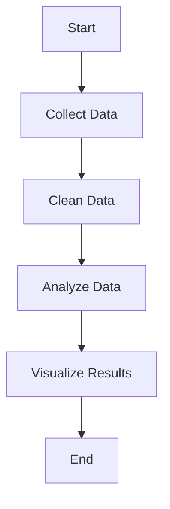

# Markdown Cheat Sheet

This file contains examples of Markdown syntax learned in the Data Integration module at TH Köln.

## Table of Contents

- [Text](#text)
- [Lists](#lists)
- [Links and Images](#links-and-images)
- [Code](#code)
- [Quotes](#quotes)
- [Tables](#tables)
- [Layout](#layout)
- [GitHub Extras](#github-extras)
- [Pitfalls](#pitfalls)

---

## Text

### 1. Headings

**Type:** CommonMark

**Explanation:** Headings are used to organize text into different sections and levels.

**Markdown Source:**

````markdown
# Heading
## Heading 2
### Heading 3
````

**Rendered Result:***

# Heading 1
## Heading 2
### Heading 3


### 2. Paragraphs and Line Breaks

**Type:** Common Mark

**Explanation:** A blank line creates a new paragraph. Two spaces at the end of a line or `<br>` create a line break.  
**Markdown Source:**

```markdown
This is the first paragraph.

This is the second paragraph.

This is the first line.  
This is the second line.

First line<br>
Second line
```

### 3. Italic, Bold, and Both

**Type:** CommonMark

**Explanation:** One asterisk makes text italic, two make it bold, and three combine both.

**How to Write It (Markdown Code):**

```markdown
*Italic text*
**Bold text**
***Bold and italic text***
```

**Rendered Result:**

*Italic text*

**Bold text**

***Bold and italic text***


### 4. Strikethrough

**Type:** GitHub

**Explanation:** Strikethrough is used to cross out text that is no longer correct or relevant.

**Markdown Source:**

```markdown
~~This is old information.~~

The meeting is on ~~Monday~~ Tuesday.
```

**Rendered Result:**

~~This is old information.~~

The meeting is on ~~Monday~~ Tuesday.


### 5. Inline Code

**Type:** CommonMark

**Explanation:** Inline code is used to display code, commands, or filenames within a sentence.

**Markdown Source:**

```markdown
Use `print("Hello World")` to print a message in Python.

The file is called `README.md`.

You can use the `git status` command to check your repository.
```

**Rendered Result:**

Use `print("Hello World")` to print a message in Python.

The file is called `README.md`.

You can use the `git status` command to check your repository.


### 6. Escaping Characters

**Type:** CommonMark

**Explanation:** A backslash is used to display special Markdown characters as normal text without applying formatting.

**Markdown Source:**

```markdown
\*This is not italic.\*

\# This is not a heading.

\**This is not bold.**

\[This is not a link\]
```

**Rendered Result:**

\*This is not italic.\*

\# This is not a heading.

\**This is not bold.**

\[This is not a link\]


## Lists
### 7. Unordered, ordered, and nested lists
- Data
- Visualization
  - Charts
  - Maps

1. Find a dataset
2. Clean it
3. Analyze it

### 8. Task Lists
- [x] Create repository
- [ ] Finish lab


## Links and Images

### 9. Inline and Reference-Style Links
[TH Köln](https://www.th-koeln.de/)

[GitHub][github]

[github]: https://github.com/

### 10. Relative Link to a Repository File
[Repository README](../../README.md)

### 11. Link to a Section
[Jump to Lists](#lists)

### 12. Image with Alt Text
/github.githubassets.com/images/modules/logos_page/GitHub-Mark.png)

### 13. Image as a Link
[](https://github.com/)

## Code
### 14. Fenced Code Blocks and Syntax Highlighting
```python
print("Hello, world!")
```

```bash
python --version
```

```json
{"name": "Ulku", "semester": 3}
```

## Quotes
### 15. Blockquotes, Nested Quotes, and Formating
> Data needs context.
> **Important:** Always check your sources.
>
>> This is a nested quote with *italic text*.

### 16. Alerts
> [!NOTE]
> Check the licence before reusing a dataset.


## Tables
### 17. Aligned Columns, Links, and a Pipe Inside a Cell
| Tool | Purpose | Example |
| :--- | :---: | ---: |
| [Python](https://python.org/) | Analysis | 1 |
| SQL | Query A \| B | 2 |

## Layout
### 18. Horizontal Rules
Above the line.

---

Below the line.

### 19. Collapsible Sections
<details>
<summary>Show hint</summary>

This text is hidden until you expand it.

</details>

### 20. Comments That Do Not Render
Visible text.

<!-- This note is not visible in the preview. -->

## GitHub Extras
### 21. Footnotes
Open data needs clear documentation.[^source]

[^source]: See the dataset's metadata and licence.

### 22. Emoji Shortcodes
:smile: :rocket:

### 23. Mentions and Issue References
@breuert

#1

### 24. Mermaid Diagram

### 25. Mathematical Formula
The mean is $\bar{x} = \frac{1}{n}\sum_{i=1}^{n} x_i$.


## Pitfalls
These are examples of problems worth testing. Replace or adapt them to describe at least three things you personally observed during your tests.
1. Single line break disappeared: Pressing Enter once did not consistently make a visible line break. Fix: I used two trailing spaces or <br>

2. Pipe split a table cell: Writing A | B inside a cell created an extra column. Fix: I escaped the pipe as A \| B.

3. Issue reference did not link: Writing #1 did not produce a usable issue link when issue 1 did not exist. Fix: I checked the issue number and used an existing issue reference when available.

4. GitHub extensions differed from CommonMark: Tables, alerts, and Mermaid did not render the same way in the CommonMark reference renderer. Fix: I labeled them as GitHub features and compared both renderers.
