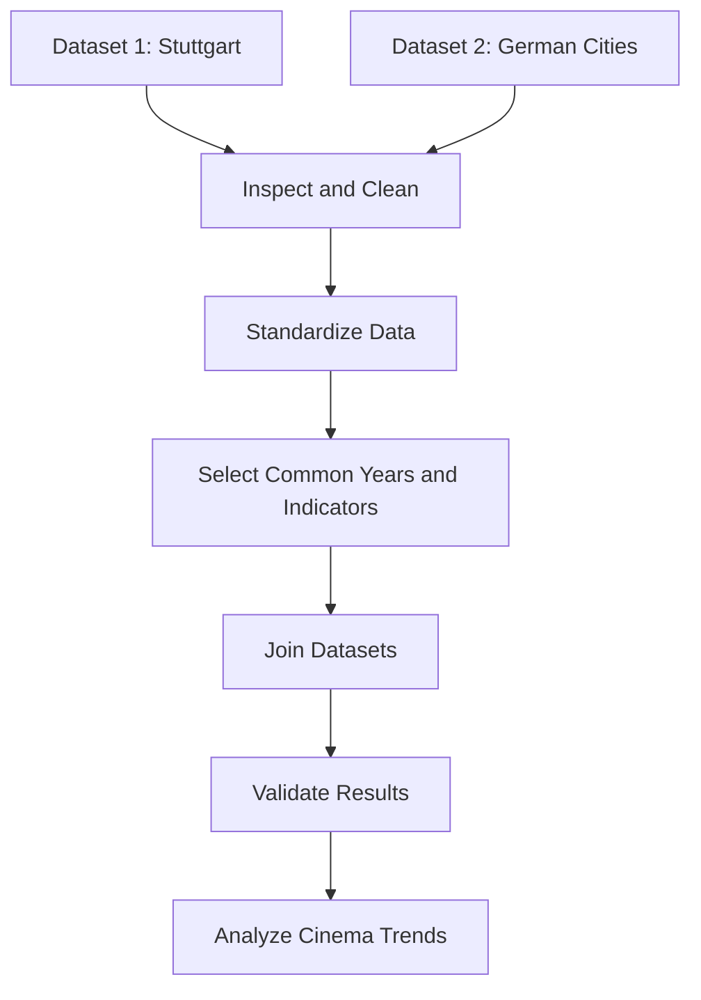

# Dataset Analysis - Cinema Attendance Trends
## Task 5 - Find Dataset
### 1. Dataset Search

For my Data Integration project, I am interested in cinema attendance trends in Germany.

I want to explore how cinema attendance has changed over time, especially before, during and after the COVID-19 pandemic.

I am also interested in the possible relationship between cinema attendance and the increasing popularity of streaming services.

To find suitable data, I searched different open data platforms.

#### Source 1: GovData
**Link:** [Kinos und Filmbesucher](https://www.govdata.de/suche/daten/kinos-und-filmbesucher)
**Format:** CSV
**License:** CC BY 4.0

I found a dataset called "Kinos und Filmbesucher", published by the Statistical Office of Stuttgart.

The dataset contains information about cinema attendance, cinemas, screens and seats in Stuttgart.

It is available as a CSV file and covers the years 1981–2025.

#### Source 2: Kaggle
**Link:** [Letterboxd Movie Ratings Data](https://www.kaggle.com/datasets/samlearner/letterboxd-movie-ratings-data)
**Format:** CSV
**License:** CC BY 4.0 (as stated on Kaggle)

**Description:**
This dataset contains movie information, user ratings and user data collected from Letterboxd. The movie data was also enriched with information from TMDB.
It includes three CSV files:

`movie_data.csv`
`ratings_export.csv`
`users_export.csv`

**Possible use:**
I could use this dataset to analyze movie genres, user ratings and film popularity.

It could help me explore audience preferences and identify patterns in movie ratings.

However, the dataset does not directly measure cinema attendance. It also contains scraped data, so the original sources and their usage conditions need to be considered.

#### Source 3: GovData
**Link:** [Kinos and Filmbesucher im Großstadtvergleich](https://www.govdata.de/suche/daten/kinos-und-filmbesucher-im-grossstadtvergleich)
**Format:** CSV
**License:** CC BY 4.0
**Data source:** FFA

**Description:** 
This dataset contains statistics about cinema attendance in major German cities.
It provides information about:

- Number of cinema locations
- Number of cinema screens
- Number of cinema seats
- Number of cinema visits

**Possible use:**
I could use this dataset to compare cinema attendance trends between different German cities.

It would also allow me to investigate changes before and after the COVID-19 pandemic.

One limitation is that the criteria for including cities changed in 2022. Therefore, comparisons across years require careful attention to the cities included.

### 2. Search like a machine
#### GovData API Search
| Information | Result |
|---|---|
| Search term | kino |
| Number of hits (`count`) | 129 |
| Title of the first hit | Kino |
| Publisher | Stadtverwaltung Norderstedt |
| Dataset licence (`license_id`) | Empty |
| Resource licence (`resources[].license`) | Empty for all 6 resources |

#### Open.NRW API Search
| Information | Result |
|---|---|
| Search term | kino |
| Number of hits (`count`) | 33 |
| First dataset | POI – Kinos |
| Publisher | Regionalverband Ruhr |
| Number of resources | 5 |
| Licence | Datenlizenz Deutschland – Namensnennung 2.0 |
| Licence location | Dataset level |

### My choice
I chose **Source 1: GovData -> Kinos und Filmbesucher**. I selected this dataset because it provides historical data about cinema attendance in Stuttgart.

The dataset allows me to analyze how cinema visits
have changed over time, especially before, during
and after the COVID-19 pandemic.
It is available in CSV format, which makes it
suitable for data analysis.

However, the dataset only covers Stuttgart,
so it does not represent cinema attendance
in Germany as a whole.

## Task 6 – Profile the Dataset

### 1. Dataset Facts

| Information | Value |
|---|---|
| Title | Kinos und Filmbesucher |
| Publisher | Statistisches Amt der Landeshauptstadt Stuttgart |
| Original Data Source | Filmförderungsanstalt (FFA) |
| Dataset URL | [OpenData Stuttgart](https://opendata.stuttgart.de/dataset/kinos-und-filmbesucher) |
| Format | CSV |
| Number of Files | 1 |
| File Size | 8 KB |
| Number of Rows | 264 |
| Number of Columns | 3 |
| Time Coverage | 1981–2025 |
| Geographical Coverage | Stuttgart, Germany |
| Granularity | Annual |
| Last Update | 26 March 2026 |
| Update Frequency | Annually |
| Licence | CC BY 4.0 |

The CSV file contains three columns: Jahr, Kategorie and Wert.

The data uses semicolons (;) as separators and commas (,) as decimal separators.

I examined the CSV file using Python and pandas.

--------
### 2. Stars
Rating: 3 stars (★★★)

The dataset is available online under a CC BY 4.0 licence.

It is provided as a CSV file, which is machine-readable and does not require proprietary software.

However, the CSV does not use URIs to identify individual data elements or provide links to related datasets.

### 3.Open Data
I downloaded the CSV file and analyzed it using Python and pandas in Jupyter Notebook. Dataset Structure

The dataset contains:

264 rows
3 columns
44 years (1981–2024)
6 different categories

The three columns are Jahr, Kategorie and Wert.

**Descriptive Statistics**

First, I calculated the minimum, maximum and mean values for the Jahr and Wert columns.

| Columns | Minimum | Maximum | Mean |
|---------|---------|---------|------|
| Jahr | 1981 | 2024 | 2002.50 |
| Wert | 0 | 13003 | 1601.63 |

However, the Wert column contains different measurement units.

For example, it includes cinema visits, cinema screens and seats.

Therefore, calculating one mean for the entire column is not very meaningful.

To get more useful results, I grouped the data by Kategorie.

**Statistics by Category**
| Columns | Minimum | Maximum | Mean |
|---------|---------|---------|------|
| Besucher | 0 | 2876 | 1869.02 |
| Kinobesucher | 0 | 5.2 | 3.21 |
| Kinosäle | 0 | 56 | 33.09 |
| Kinotheater | 0 | 47 | 19.34 |
| Sitzplätze | 0 | 13003 | 7672.09 |
| Vorhandene Plätze je 1000 Einwohner | 0 | 22.9 | 13.03 |

These results include zero values.

**Missing Values**

I used pandas to check for missing values.
| Columns | Minimum Values|
|---------|---------|
| Jahr | 0 |
| Kategorie | 0 |
| Wert | 0 |

There are no empty cells recognized as missing values by pandas.

However, I found 53 zero values in the Wert column.

Most of these zero values appear in earlier years.

For example, in 1983, the dataset reports 47 cinemas but zero cinema screens and seats.

This suggests that some zeros might represent missing information rather than actual values.

I would need to check the original documentation before replacing or removing them.

**Data Quality Observations**

During the analysis, I noticed the following:

The CSV uses semicolons (;) as column separators.
Decimal numbers use commas (,) instead of dots.
The Wert column contains different measurement units.
Some zero values may represent unavailable data.
The downloaded CSV ends in 2024, although the online metadata states 2025.

These issues should be considered before using the dataset for further analysis.

Tool used: Jupyter Notebook with Python and pandas.

### 4. Data Dictionary

The original CSV file contains only three columns, although the assignment asks for five.

Therefore, I describe all three original columns and additionally explain the six indicators stored in the Kategorie column.

| Columns | Meaning | Data Type | Unit | Example |
|---------|---------|-----------|------|---------|
| Jahr | Year of observation | Integer | Year | 2024 |
| Kategorie | Type of cinema statistic | String | None | Kinotheater |
| Wert | Value of the statistic | Float | Depends on category | 47.0 |

**Documentation**

The publisher provides a dataset description explaining the general content, geographical coverage, original data source and update frequency.

However, I could not find a separate detailed data dictionary explaining every column and its possible values.

### 5. Licence
The dataset is published under the `Creative Commons Attribution 4.0 International (CC BY 4.0)` licence.

This licence allows users to:

Copy and share the data.
Modify and transform the data.
Use the data for research and other purposes.
Redistribute the data, including commercially.

However, users must give appropriate credit, provide a link to the licence and indicate whether changes were made.

**Is the Dataset Open?**

Yes, the dataset is open according to the Open Definition.

The CC BY 4.0 licence allows reuse, modification and redistribution as long as attribution requirements are followed.

### 6.People
The dataset does not contain identifiable personal data.

It includes aggregated cinema statistics, such as the number of cinema visits, seats and cinema locations.

## Task 7 – FAIR Principles

### 1. FAIR Assessment

I evaluated the dataset "Kinos und Filmbesucher" using the FAIR principles.

For each principle, I used the following ratings:

- ✓ = Yes
- ~ = Partly
- ✗ = No

| Principle | Rating | Explanation / Evidence |
|---|---|---|
| **F1 – Unique Identifier** | ~ | The dataset has a stable URL on OpenData Stuttgart, but I could not find a DOI or another guaranteed persistent identifier. |
| **F2 – Rich Metadata** | ✓ | The dataset provides a title, description, publisher, source, dates, geographical coverage, keywords and licence information. |
| **F4 – Searchable Resource** | ✓ | The dataset can be found through OpenData Stuttgart and GovData. |
| **A1 – Accessibility** | ✓ | The CSV file can be downloaded using HTTPS without registration or login. |
| **I1 – Machine-Readable Format** | ✓ | The dataset is provided as a CSV file, which is an open and machine-readable format. |
| **I2, I3 – Standards and Links** | ~ | The dataset uses years and category names, but I could not identify standardized codes or direct links to related datasets inside the CSV file. The metadata references the original data source (FFA). |
| **R1 – Reusability** | ~ | The dataset provides a description and information about its content, but there is no detailed data dictionary explaining all values. Some zero values also need further investigation. |
| **R1.1 – Licence** | ✓ | The dataset uses the CC BY 4.0 licence, which allows reuse and modification with attribution. The licence is clearly stated on the dataset page. |
| **R1.2 – Provenance** | ~ | The publisher and original data source (Filmförderungsanstalt) are identified. However, the detailed data collection and processing methods are not fully documented. |
| **R1.3 – Community Standards** | ~ | The dataset is published on an official open data portal with structured metadata. However, I have not verified whether its metadata fully follows DCAT-AP or another community standard. |

### 2. Is the Dataset FAIR, Open, or Both?

The dataset is open because it is available under the CC BY 4.0 licence and can be downloaded in CSV format.

It also meets several FAIR principles, especially Findability and Accessibility.

However, it does not fully meet all FAIR principles. For example, the documentation could be more detailed, and the data does not provide clear links to related datasets.

Therefore, I would describe the dataset as **open and partly FAIR**.

### 3. Improvements for Milestone 2

When publishing our own dataset for Milestone 2, I would improve three things:

1. **Better documentation:** I would create a detailed data dictionary explaining every column, its data type, unit and possible values.

2. **Clear metadata and licence:** I would provide a stable identifier, publisher information, update dates and a machine-readable licence.

3. **Better interoperability:** I would use standardized date formats and identifiers, and provide links to the original data sources.

These improvements would make our dataset easier to find, understand, combine and reuse.

## Task 8 – Plan What to Combine It With

### 1. Second Data Source

For my Data Integration project, I would like to combine my selected dataset with another dataset about cinema attendance in German cities.

**Dataset 1:** [Kinos und Filmbesucher](https://www.govdata.de/suche/daten/kinos-und-filmbesucher)

**Dataset 2:** [Kinos und Filmbesucher im Großstadtvergleich](https://www.govdata.de/suche/daten/kinos-und-filmbesucher-im-grossstadtvergleich)

**Publisher:** Statistisches Amt der Landeshauptstadt Stuttgart

**Original Data Source:** Filmförderungsanstalt (FFA)

**Format:** CSV

**Licence:** CC BY 4.0

The first dataset contains historical cinema statistics for Stuttgart.

The second dataset contains information about cinema attendance, cinema locations, screens and seats in selected major German cities.

I chose this second dataset because I want to compare the development of cinema attendance in Stuttgart with other German cities.

### 2. Shared Key

To combine two datasets, they need at least one common key.

Both datasets contain annual cinema statistics, so the year can be used as a shared key.

The first dataset contains the column `Jahr`, and the second dataset also provides annual observations.

However, the exact column names and structure of the second CSV still need to be checked.

#### Possible Matching Years

The following table shows three years that fall within the reported time coverage of both datasets.

| Dataset 1: Stuttgart | Dataset 2: Großstadtvergleich |
|---|---|
| 1997 | 1997 |
| 2000 | 2000 |
| 2024 | 2024 |

These years are possible matching keys. The values in the second CSV still need to be checked.

For a correct comparison, I would also need to select Stuttgart from the second dataset and match equivalent indicators, such as cinema visits.

The category names and measurement units might be different, so they may need to be standardized before combining the datasets.

### 3. Granularity

The two datasets have similar temporal granularity because both provide annual statistics.

However, their geographical coverage is different.

| Feature | Dataset 1 | Dataset 2 |
|---|---|---|
| Geographical coverage | Stuttgart | Selected German cities |
| Time coverage | 1981–2024 (downloaded CSV) | 1997–2025 (portal metadata) |
| Temporal granularity | Annual | Annual |
| Main indicators | Cinemas, screens, seats, visits | Cinema locations, screens, seats, visits |

To align the datasets, I would:

1. Select the overlapping years.
2. Compare the available cities and indicators.
3. Standardize the column names.
4. Check that the values use the same measurement units.
5. Combine the datasets using the year and, where appropriate, the city and indicator.

One important limitation is that the second dataset only includes selected major cities.

Additionally, the inclusion criteria changed in 2022. This needs to be considered when comparing cities over time.

### 4. Research Questions

By combining these two datasets, I would like to answer the following questions:

**Research Question 1:**

How does the development of cinema attendance in Germany looks like pre versus post COVID-19 pandemic?

**Research Question 2:**

Is cinema culture returning to German culture after the rise of streaming platforms?

**Research Question 3:**

Does the relationship between the number of cinema screens and cinema visits differ between Stuttgart and other major German cities?

These questions require information from both datasets because the first dataset focuses on Stuttgart, while the second provides a comparison with other cities.

### 5. Licences

Both datasets are published under the Creative Commons Attribution 4.0 International (CC BY 4.0) licence.

This licence allows the data to be copied, modified, combined and redistributed.

However, the original publishers must be credited, the licence must be linked and any modifications must be indicated.

Since both datasets use CC BY 4.0, they can be combined and the resulting dataset can be published, provided that the attribution requirements are respected.

#### Attribution

**Dataset 1:**

"Kinos und Filmbesucher", Statistisches Amt der Landeshauptstadt Stuttgart, based on FFA data, [Source](https://www.govdata.de/suche/daten/kinos-und-filmbesucher), [CC BY 4.0](https://creativecommons.org/licenses/by/4.0/).

**Dataset 2:**

"Kinos und Filmbesucher im Großstadtvergleich", Statistisches Amt der Landeshauptstadt Stuttgart, based on FFA data, [Source](https://www.govdata.de/suche/daten/kinos-und-filmbesucher-im-grossstadtvergleich), [CC BY 4.0](https://creativecommons.org/licenses/by/4.0/).

Any cleaning, transformation or combination of the original data would also be documented.

### 6. Next Steps – Data Integration

To combine the two datasets, I would follow these steps:

1. **Download:** Download both CSV files from their original publisher.
2. **Inspect:** Open the files and examine their columns and data types.
3. **Clean:** Check missing values, zero values and possible inconsistencies.
4. **Standardize:** Make sure years, city names, indicators and units are consistent.
5. **Filter:** Select the relevant years and cities.
6. **Join:** Combine the datasets using suitable shared keys.
7. **Validate:** Check whether the merged dataset contains duplicates or missing matches.
8. **Analyze:** Compare cinema attendance trends across cities.

#### Mermaid Flowchart

The flowchart shows the planned data integration process from downloading the datasets to analyzing the combined data.

### 7. Verdict

I would use the Stuttgart dataset as a starting point for my project because it provides historical cinema attendance data in an open and machine-readable format.

Combining it with the Großstadtvergleich dataset would allow me to compare Stuttgart with other German cities and investigate differences in cinema attendance trends.

Later on i would another dataset that is going to be showing the rise of streaming platforms in Germany to compare two aspects.

The biggest risk is that some values may be missing or inconsistent and that the geographical coverage and selection criteria of the second dataset change over time.

### 8. Sources

- [Kinos und Filmbesucher – GovData](https://www.govdata.de/suche/daten/kinos-und-filmbesucher)
- [Kinos und Filmbesucher im Großstadtvergleich – GovData](https://www.govdata.de/suche/daten/kinos-und-filmbesucher-im-grossstadtvergleich)
- [OpenData Stuttgart](https://opendata.stuttgart.de/)
- [Creative Commons CC BY 4.0](https://creativecommons.org/licenses/by/4.0/)
